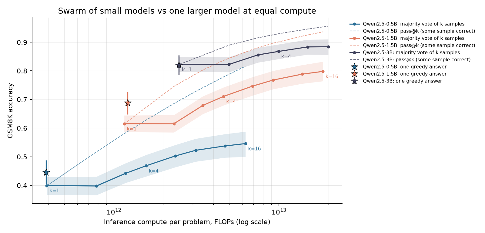
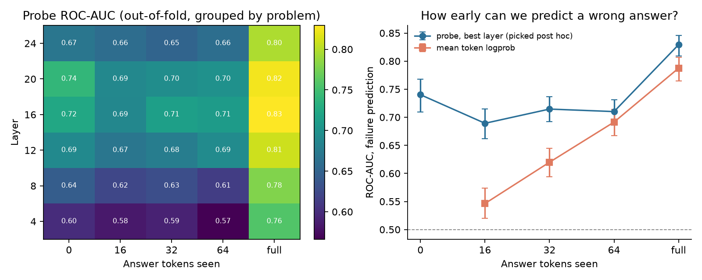

# swarm-probe

**Can a swarm of small LLMs replace one larger model at equal compute — and can the model's hidden
states tell in advance which of its answers are wrong?**

A small, fully reproducible study on GSM8K with Qwen2.5-Instruct 0.5B / 1.5B / 3B
(500 problems, ~20k generated solutions, Kaggle T4).

## TL;DR

- **A bigger model beats a bigger swarm.** At equal inference compute, majority voting over samples of
  a small model loses to a single greedy answer of a larger one by 20–32 pp. Even 16 samples of the
  1.5B model, at 7.5× the compute, do not reach one greedy pass of the 3B model (79.8% vs 82.0%).
- **The swarm's bottleneck is aggregation, not knowledge.** In 81.6% of problems at least one of
  16 samples from the 0.5B model is correct — as often as the 3B model's greedy answer — but
  majority voting recovers only 54.6%.
- **Hidden states know more than token probabilities.** A linear probe on layer 16 predicts a wrong
  final answer with ROC-AUC 0.83 vs 0.79 for mean token log-probability; 16 tokens into the answer
  the gap is 0.69 vs 0.55.
- **…but early signal is about the problem, not the sample.** Before the answer is complete, the probe
  ranks samples of the *same* problem at chance (within-problem AUC ≈ 0.50): it detects hard
  problems early, not failing reasoning paths.
- **Probe-weighted voting helps a little.** Weighting votes by probe confidence (cell fixed before
  seeing results) adds +3.6 pp over majority voting (95% CI +1.2…+6.0) and +2.4 pp over
  log-probability weighting (CI 0.0…+4.6) — a small slice of the 27 pp aggregation gap.



## Questions

| | Question | Measured by |
|---|---|---|
| **Q1** | Does majority voting over *k* samples of a small model match one larger model at equal compute? | Accuracy vs FLOPs per problem |
| **Q2** | Can a linear probe on hidden states predict that an answer will be wrong — before or during generation? | Out-of-fold ROC-AUC, grouped by problem |
| **Q3** | Does weighting votes by the probe's confidence improve the swarm? | Paired bootstrap vs majority and log-prob weighting |

## Setup

- **Data:** 500 problems from the GSM8K test split (fixed random subset, seed 0); numeric answer,
  exact-match scoring, answer taken from the last `\boxed{}` (fallback: last number).
- **Models:** Qwen2.5-Instruct 0.5B / 1.5B / 3B, fp16, HF `transformers` on a Kaggle T4, chat
  template with a "reason step by step, answer in `\boxed{}`" system prompt, up to 512 new tokens.
- **Sampling:** one greedy answer per model, plus 16 / 16 / 8 samples at temperature 0.7, top-p 0.95.
- **Compute:** `2 · N_params · (prompt + generated tokens)` per sample; vote@k costs *k* samples.
- **Vote@k:** expected accuracy of majority voting over random *k*-subsets of the samples (200 draws
  per problem), 95% CI by bootstrap over problems. Ties go to the earliest sample, so vote@2 equals
  vote@1 by construction.
- **Probe:** hidden states of the 0.5B model at the last prompt token, after 16 / 32 / 64 answer
  tokens and at the last answer token, layers 4–24; standardized logistic regression (C = 0.1),
  5-fold `GroupKFold` by problem so that samples of one problem never straddle train and test;
  95% CI by bootstrap over problems.
- **Fixed in advance** ([PLAN.md](PLAN.md)): the Q3 headline cell (full answer, layer 16) and that
  the "best layer" curve in Q2 is reported as picked post hoc.

## Results

### Q1 — swarm vs single model

| Budget (FLOPs / problem) | Swarm (majority vote) | Single larger model (greedy) |
|---|---|---|
| ≈ 1.2 · 10¹² | 0.5B × 3: **44.2%** [40.9, 47.8] | 1.5B: **68.8%** [64.8, 72.6] |
| ≈ 2.4 · 10¹² | 0.5B × 6: **50.3%** [46.4, 54.1] · 1.5B × 2: **61.5%** | 3B: **82.0%** [78.6, 85.4] |
| 2.5× the 3B budget | 0.5B × 16: **54.6%** [50.0, 58.8] | 3B: 82.0% |
| 7.5× the 3B budget | 1.5B × 16: **79.8%** [76.4, 83.2] | 3B: 82.0% |

| Model | Greedy | Vote@16 (3B: @8) | pass@16 (3B: @8) |
|---|---|---|---|
| 0.5B | 44.6% | 54.6% | 81.6% |
| 1.5B | 68.8% | 79.8% | 93.6% |
| 3B | 82.0% | 88.4% | 95.6% |

A single sample at temperature 0.7 is worse than the greedy answer for the small models
(40.0% vs 44.6% for 0.5B, 61.6% vs 68.8% for 1.5B), so part of the voting gain only buys back what
sampling loses. Full tables: [`results/q1_swarm.csv`](results/q1_swarm.csv),
[`results/q1_greedy.csv`](results/q1_greedy.csv).

### Q2 — predicting failures from hidden states



| Answer tokens seen | Probe, layer 16 | Mean token log-prob | Probe, within-problem AUC |
|---|---|---|---|
| 0 (before answering) | 0.724 [0.692, 0.753] | — | 0.50 |
| 16 | 0.688 [0.662, 0.714] | 0.546 [0.520, 0.574] | 0.50 |
| 32 | 0.715 [0.693, 0.737] | 0.620 [0.594, 0.644] | 0.51 |
| 64 | 0.710 [0.686, 0.731] | 0.691 [0.668, 0.714] | 0.51 |
| full answer | **0.829** [0.809, 0.846] | 0.787 [0.764, 0.807] | **0.70** |

Answer length alone gives 0.703 on the full answer. Middle layers (16–20) are consistently best.
The within-problem column is the key caveat: early probes rank *problems* by difficulty, not
*samples* by correctness. Full grid: [`results/q2_probe_auc.csv`](results/q2_probe_auc.csv).

### Q3 — probe-weighted voting (0.5B, 16 samples)

| Aggregation | Accuracy | Δ vs majority [95% CI] |
|---|---|---|
| Majority vote | 54.6% | — |
| Weighted by log-prob classifier | 55.8% | +1.2 pp [−0.6, +3.2] |
| **Weighted by probe (preregistered cell)** | **58.2%** | **+3.6 pp [+1.2, +6.0]** |
| Oracle (any sample correct) | 81.6% | +27.0 pp |

Probe vs log-prob weighting: +2.4 pp [0.0, +4.6]. See
[`results/q3_preregistered.csv`](results/q3_preregistered.csv); the exploratory sweep over all cells
is in [`results/q3_weighted_vote.csv`](results/q3_weighted_vote.csv).

## What this suggests

1. For homogeneous swarms at this scale, the cheap win is model size, not sample count. Swarms are
   worth it only if their members fail *differently* — here samples of one model share their errors.
2. The 27 pp gap between pass@16 and vote@16 is the real opportunity: a better *selector* among
   answers the swarm already produced. Hidden-state probes are a cheap selector, but a linear probe
   on one layer closes only ~13% of the gap.
3. Early failure prediction and early sample selection are different problems. Detecting that a
   problem is hard can be done before generation; telling which reasoning path will fail needs most
   of the path.

## Limitations

One benchmark (GSM8K), one model family, 500 problems, one temperature. FLOPs are a proxy: they
ignore shared prefill, KV caching and hardware efficiency, which favour batched sampling. The probe
is linear and trained in-distribution (cross-validated by problem, not tested on new tasks). The swarm
is homogeneous — a mix of models or prompts could behave differently.

## Reproduce

```bash
uv sync --extra gpu
uv run pytest
```

Generation and feature extraction run as Kaggle kernels ([`kaggle/runner.py`](kaggle/runner.py) with
[`configs/full.json`](configs/full.json) and [`configs/features_full.json`](configs/features_full.json));
the analysis runs on a laptop:

```bash
uv run python scripts/analyze_swarm.py <generation_dir>
uv run python scripts/analyze_probe.py <features.npz> <generation_dir>
uv run python scripts/q3_paired.py <features.npz> <generation_dir>
```

## Layout

```
src/swarm_probe/   answers.py (parsing) · voting.py (vote@k, pass@k, bootstrap) · generate.py ·
                   features.py (hidden states) · probe.py (grouped CV probe, AUC) · analysis.py · plots.py
scripts/           analyze_swarm.py (Q1) · analyze_probe.py (Q2) · q3_paired.py (Q3)
configs/           generation and feature-extraction plans
kaggle/            kernel entry point
results/ figures/  tables and plots used above
tests/             pytest suite
```
